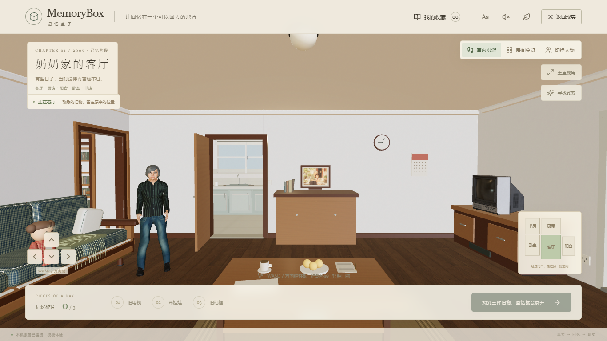

# MemoryBox · 记忆盒子

让回忆有一个可以回去的地方。一段可行走的 3D 回忆之旅：现实木盒 → 讲述记忆 → 探索老屋 → 真实 / 想象分支 → 写信 → 带着收藏回到现在。

## 直接体验：双击 index.html

1. [下载离线体验包](https://github.com/lihao123456521/memorybox/releases/download/v0.2.0/MemoryBox-offline-v0.2.0.zip)。要和队友修改源码，可从[公开仓库](https://github.com/lihao123456521/memorybox)选择 **Code → Download ZIP**，或[下载源码 ZIP](https://github.com/lihao123456521/memorybox/archive/refs/heads/main.zip)。两种包都带可直接打开的根目录 `index.html`。
2. 解压后，用 Chrome 或 Edge 打开根目录的 **`index.html`**。
3. 不需要安装 Node.js、Python、数据库或任何 API Key，也不需要启动本地服务。

根目录 `index.html` 是约 26 MiB 的完整离线成品，内嵌代码、样式、GLB 人物、PBR 贴图与合影。它可以单独复制到其他文件夹或电脑，不依赖旁边的 `frontend` 文件夹。`frontend/index.html` 是开发入口，不是离线成品。

离线模式中的草稿、信件和人物选择保存在各自浏览器里。它们不会自动上传 GitHub，也不会随源码下载共享给别人。叙事使用明确标记的本地模板，不假称实时大模型生成。

下面是本版单文件实际运行画面，场景可进入和行走：



## 场景与操作

- 真实尺度的客厅、厨房与阳台，通过实际门洞通行；窗外街道、树木、住宅与车辆均为三维几何。
- 默认 **室内漫游**：WASD / 方向键移动，鼠标或手指拖动环顾。无需 Pointer Lock。触屏也可以按住画面方向按钮移动。
- 墙壁、家具与人物占位有碰撞限制，不能直接穿过茶几或墙。右下平面图显示当前所在区域。
- **房间总览** 可旋转观察，切回漫游保留之前的位置；点击旧电视、布娃娃和相框，依次发现三件不同的记忆。
- **切换人物** 提供青年男性、长者男性、青年女性、长者女性四种独立外观。人物采用真实人体拓扑与本地皮肤纹理，保持完整衣着。
- 三件物品解锁两种路线。想象分支持续标记 **AI 想象 · 并非真实历史**；写信后回到同一个现实木盒并查看收藏。
- 支持退出继续、刷新恢复、重玩保留收藏、删除、音效开关、大字和减少动态效果。

「家的模样」是完整空间旅程；车站与教室目前是明确标注的叙事预览，共用老屋场景。

## 一起修改

[团队开发说明](CONTRIBUTING.md) 包含 Fork / Pull Request、分支与成品更新方法。公开仓库允许所有人浏览和下载；没有写权限的队友可以在自己的 Fork 中修改并提交 Pull Request。

```powershell
git clone https://github.com/lihao123456521/memorybox.git
Set-Location memorybox
git switch -c feature/your-change
```

主要编辑位置：

| 内容 | 源码 |
|---|---|
| 故事流程、界面、人物设置 | `frontend/src/App.tsx` |
| 标准房间、家具与三个区域 | `frontend/src/scenes/Room.tsx` |
| 移动、镜头与碰撞 | `frontend/src/scenes/WalkController.tsx`、`navigation.ts` |
| 人物加载与可复建模型 | `frontend/src/scenes/Characters.tsx`、`frontend/public/assets/models/build-characters.mjs` |
| 本地故事模板与状态恢复 | `frontend/src/data.ts`、`store.ts` |
| API、数据库与幂等保存 | `backend/app` |
| 单文件打包 | `frontend/scripts/build-portable.mjs` |

## 启动开发环境

以下仅供修改源码时使用。需要 Node.js 和 Python；本轮使用 Node 24、Python 3.14 实际运行。

Windows 在项目根目录一键启动前后端：

```powershell
powershell.exe -NoProfile -ExecutionPolicy Bypass -File .\start-memorybox.ps1
```

前端：[http://127.0.0.1:5173](http://127.0.0.1:5173)；后端健康检查：[http://127.0.0.1:8000/api/health](http://127.0.0.1:8000/api/health)。服务仅绑定本机地址，日志位于忽略提交的 `artifacts/runtime`。

也可分别启动：

```powershell
# 终端一，在项目根目录
Set-Location backend
python -m venv .venv
.\.venv\Scripts\python.exe -m pip install -r requirements.txt
.\.venv\Scripts\python.exe -m uvicorn app.main:app --host 127.0.0.1 --port 8000
```

```powershell
# 终端二，在项目根目录
Set-Location frontend
npm.cmd ci
npm.cmd run dev
```

HTTP 开发版后端可用时把回忆和信件保存到本机 SQLite，并以当前浏览器随机凭据隔离；断线可离线体验，恢复后手动同步。文件协议离线成品始终使用浏览器存储，不连接 localhost。

## 验证与重新生成离线成品

```powershell
Set-Location frontend
npm.cmd ci
npm.cmd run typecheck
npm.cmd run build
npm.cmd run build:portable
npm.cmd run test:e2e
```

`build:portable` 更新根目录 `index.html`。浏览器测试复用已有 Chromium / Edge；可设置 `MEMORYBOX_BROWSER` 为浏览器完整路径。完整 HTTP 测试需要开发服务；离线测试会把唯一的 HTML 复制到空文件夹，在阻断 HTTP 的全新浏览器中打开。

后端测试：在 `backend` 运行 `.\.venv\Scripts\python.exe -m pytest -q`。GitHub Actions 自动检查类型、普通构建、离线打包和后端接口测试。

实测结果和限制见 [验证记录](docs/verification.md)。桌面浏览器的手机尺寸检查不代表实体手机、iPad 或 Safari 验证；未测量实际 GPU 帧率。

## 资源与边界

房间和家具是原创程序网格；PBR 纹理来自 Poly Haven，人物基础拓扑、形态与皮肤来自 MakeHuman 的 CC0 图形资产，衣着和转换逻辑由本项目生成。虚构合影由内置 image_gen 生成，只用于相框纹理。来源与许可见 [素材说明](THIRD_PARTY_NOTICES.md)、[人物记录](docs/character-assets.md)、[房间记录](docs/room-assets.md)。

人物目前提供自然比例的静态站姿 / 坐姿与轻微呼吸，尚未实现完整骨骼表演。Lux3D **未接入、未消费额度**；本版不宣称已经满足最终参赛版的 Lux3D 门槛。

请勿提交 `.env`、密钥、数据库、私人照片、个人信件、运行日志或依赖目录；当前 `.gitignore` 已排除这些内容。
